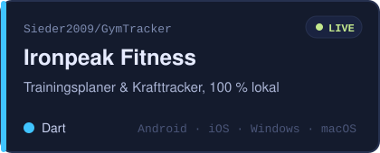
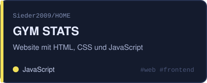

<div align="center">



<a href="https://git.io/typing-svg">
  
</a>

<br>

<a href="https://github.com/Sieder2009?tab=repositories"></a>


</div>

<br>

```console
$ flutter doctor --sieder
[✓] Flutter & Dart      Apps für Android und iOS
[✓] Web                 HTML, CSS, JavaScript
[✓] Git                 jeden Tag ein bisschen weiter
[!] Nächstes Projekt    in Planung …
```

<h2 align="center">Projekte</h2>

<div align="center">

<a href="https://github.com/Sieder2009/GymTracker"></a>
<a href="https://github.com/Sieder2009/HOME"></a>

</div>

<h2 align="center">Tech-Stack</h2>

<div align="center">
  
</div>

<h2 align="center">Commit-Streak</h2>

<div align="center">


</div>

<h2 align="center">Contribution-Snake</h2>

<div align="center">
  
</div>


