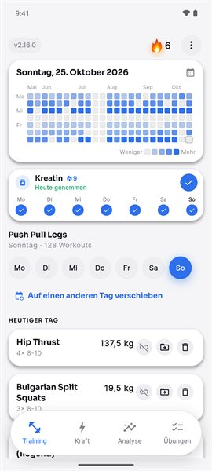
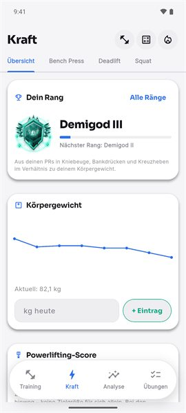
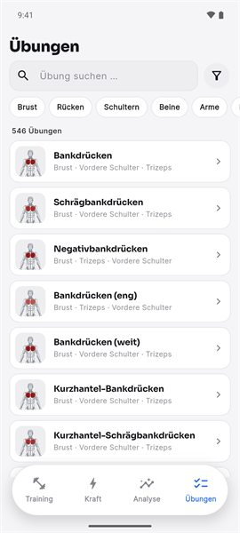

## Hi, ich bin Sieder

Ich baue Apps mit Flutter, Websites mit React und three.js und so ziemlich alles, was mit Minecraft zu tun hat.
Die meiste Zeit geht gerade in **Kilo** drauf, unsere Gym-App.

   
  ich nach <code>git push --force</code> auf main, Freitag 17:59

### Projekte

**[Kilo](https://github.com/Sieder2009/GymTracker)**: Trainingsplaner und Krafttracker für Android, iOS, Windows und macOS.
Alle Daten bleiben auf dem Gerät, ohne Konto und ohne Cloud. Zusammen mit [Plattnericus](https://github.com/Plattnericus) gebaut.
[Website](https://kilo.siggidy.dev) | [Download](https://github.com/Sieder2009/GymTracker/releases/latest)

  
  
  

**[Aurora Nights](https://github.com/Sieder2009/aurora-nights-shader)**: Shaderpack für Minecraft Java (Iris und OptiFine) mit Polarlicht, Wasserspiegelungen und 3D-Wolken.

**[HotbarX](https://github.com/Sieder2009/hotbarx-resourcepack)**: Resourcepack, das Inventar und HUD in Minecraft rot-schwarz macht.

**[Minecraft-Portfolio](https://github.com/Sieder2009/minecraft-portfolio)**: meine Minecraft-Welt zum Durchlaufen im Browser, mit Skin-Viewer. Live auf [mc.siggidy.dev](https://mc.siggidy.dev).

Dazu kommen noch ein paar private Sachen: ein Block-Puzzle in Flutter, eine Fabric-Mod, die Minecraft-Welten als 3D-Karte in den Browser bringt, und inzwischen fünf Versionen meines Portfolios, weil ich mich nie entscheiden kann.

### Womit ich arbeite

Flutter und Dart, JavaScript mit React, three.js und Vite, Java und GLSL für Minecraft, Node.js.
Gebaut wird mit GitHub Actions, online ist das meiste über Vercel.

Ingame heiße ich `affenmal`.
