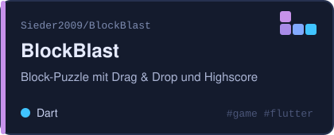
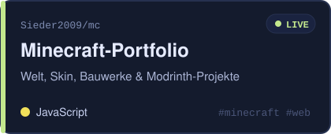

<div align="center">


<br>

<a href="https://github.com/Sieder2009?tab=repositories"></a>
<a href="https://ironpeak.siggidy.dev"></a>


</div>

<h2 align="center">👋 Hey, schön, dass du da bist!</h2>

<p align="center">
  Du bist gerade auf meinem GitHub-Profil gelandet. Gute Entscheidung! 😄<br>
  Ich bin <b>Sieder</b> und baue <b>Apps mit Flutter &amp; Dart</b> und <b>Websites mit HTML, CSS &amp; JavaScript</b>.<br>
  Am liebsten Sachen, die ich selbst benutze. Deshalb dreht sich bei mir vieles ums <b>Training</b> 🏋️
</p>

```console
$ flutter doctor --sieder
[✓] Flutter & Dart      Apps für Android, iOS, Windows & macOS
[✓] Web                 HTML, CSS, JavaScript
[✓] Ironpeak Fitness    live – probier's aus!
[✓] Git                 jeden Tag ein bisschen weiter
[!] Nächstes Projekt    in Planung … hast du eine Idee?
```

<h2 align="center">🚀 Schau dir an, was ich gebaut habe</h2>

<p align="center">Klick auf eine Karte und du landest direkt im Code.</p>

<div align="center">

<a href="https://github.com/Sieder2009/GymTracker"></a>
<a href="https://github.com/Sieder2009/Siederhub"></a>
<a href="https://github.com/Sieder2009/BlockBlast"></a>
<a href="https://github.com/Sieder2009/mc"></a>

<br><br>

<a href="https://ironpeak.siggidy.dev"></a>
<a href="https://sieder2009.github.io/Siederhub/"></a>
<a href="https://mc.siggidy.dev"></a>

</div>

<h2 align="center">🧰 Mein Werkzeugkasten</h2>

<div align="center">
  
  <br>
  <sub>Damit entsteht alles, was du hier siehst.</sub>
</div>

<h2 align="center">📊 Meine Zahlen – live aus GitHub</h2>

<div align="center">
  
  <br>
  <sub>Wird alle 12 Stunden automatisch neu berechnet.</sub>
</div>

<h2 align="center">🐍 Schau mal, die Snake frisst meine Contributions</h2>

<div align="center">
  <picture>
    <source media="(prefers-color-scheme: dark)" srcset="https://raw.githubusercontent.com/Sieder2009/Sieder2009/output/snake-dark.svg"/>
    <source media="(prefers-color-scheme: light)" srcset="https://raw.githubusercontent.com/Sieder2009/Sieder2009/output/snake-light.svg"/>
    
  </picture>
  <br>
  <sub>Jedes Kästchen ist ein Tag mit Code. Je mehr ich committe, desto mehr hat sie zu futtern.</sub>
</div>

<h2 align="center">🤝 Und jetzt du!</h2>

<div align="center">

| ⭐ | 👀 | 💬 |
|:-:|:-:|:-:|
| **Gefällt dir ein Projekt?**<br>[Lass einen Stern da](https://github.com/Sieder2009/GymTracker) –<br>das motiviert mich mega. | **Neugierig, was als Nächstes kommt?**<br>Klick auf *Follow*,<br>dann verpasst du nichts. | **Idee oder Bug gefunden?**<br>[Mach ein Issue auf](https://github.com/Sieder2009/GymTracker/issues/new) –<br>ich lese alles. |

</div>

<details>
<summary><b>🤫 Psst … du hast bis ganz nach unten gescrollt? Klick mal hier.</b></summary>
<br>

```dart
void main() {
  final besucher = Besucher(name: 'du');
  besucher.danke();        // Danke, dass du da warst!
  besucher.wiederkommen(); // Bis zum nächsten Commit 👋
}
```

Du bist offiziell der neugierigste Besucher heute. Hier, ein Keks für dich: 🍪

</details>


